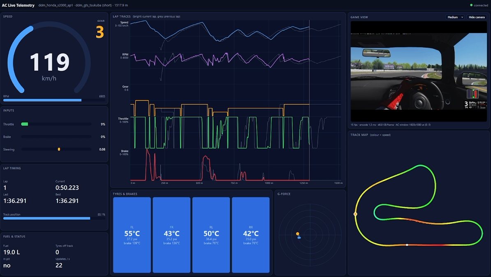
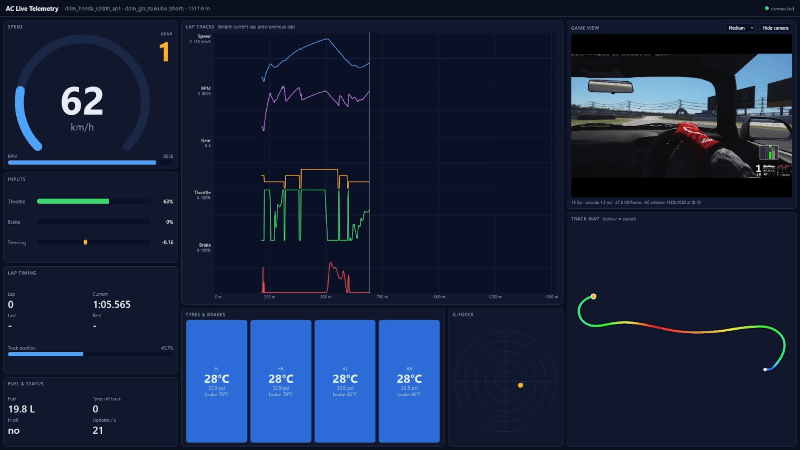
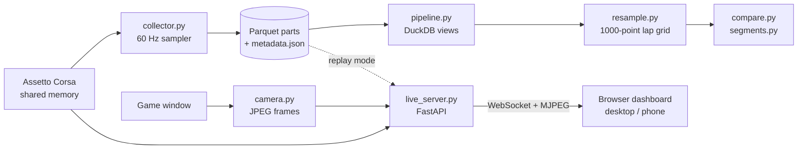

# Assetto Corsa Telemetry Dashboard

A real-time telemetry dashboard and post-session analysis pipeline for **Assetto Corsa** (original), written in Python.

It reads the game's shared memory at 60 Hz, streams it to a browser dashboard that works on desktop and phone (with a live video feed of the game), and records every session to Parquet so laps can be compared afterwards with SQL.

<!-- Add your own images to docs/ and update these two lines:


-->

## What it does

- **Records** every session at 60 Hz to Parquet files, plus a `metadata.json` (car, track, layout, track length).
- **Live dashboard** in any browser: speed gauge, gear, RPM, throttle / brake / steering, lap timing, tyre and brake temperatures, G-force plot, fuel, a **live track map** that draws itself as you drive, and **lap traces** (current lap vs previous lap) plotted by position around the track.
- **Game camera:** streams just the game window as MJPEG. It only captures while a browser is watching it, so recording costs nothing extra.
- **Works on a phone** over your local network, and the layout adapts (one screen on desktop, stacked on a phone).
- **Replay mode:** plays a recorded session through the same dashboard, with no game and no Windows needed.
- **Lap analysis in SQL (DuckDB):** lap segmentation, data-quality flags, resampling onto a common distance grid, lap overlays, and time lost per track segment.

## Architecture



| Piece | What it does |
|---|---|
| `collector.py` | Maps AC's `physics`, `graphics` and `static` shared-memory blocks with `ctypes`, samples at 60 Hz on a deadline-based loop, and writes batched Parquet part files |
| `pipeline.py` | DuckDB views: `samples`, `laps` (with quality flags) and `session_meta` |
| `resample.py`, `compare.py`, `segments.py` | Distance-based resampling, lap overlays with a time-delta plot, and time lost per track segment |
| `live_server.py`, `sources.py` | FastAPI server: WebSocket telemetry, MJPEG video, live or replay source |
| `camera.py`, `window_finder.py` | Finds the game window through the Win32 API and captures only that area, on any monitor layout |
| `static/index.html` | The dashboard (plain HTML, CSS and JavaScript with canvas drawing, no build step) |

## Quick start

Requires Python 3.10+. Recording and the live dashboard need **Windows** and the game; replay and analysis work on any OS.

```powershell
git clone https://github.com/eddygrullon02/ac-telemetry-dashboard.git
cd ac-telemetry-dashboard
python -m venv .venv
.\.venv\Scripts\Activate.ps1
python -m pip install -r requirements.txt
```

### Try it without the game (replay)

```powershell
python live_server.py --replay sample_data
```

Open http://localhost:8000. The recorded session plays back in a loop through the same dashboard.

### Record and watch a session live

1. Start Assetto Corsa and load into a session (set the game to **borderless windowed** for the camera).
2. In one terminal: `python collector.py` (records to `sessions/`, Ctrl+C to stop).
3. In another terminal: `python live_server.py`.
4. Open http://localhost:8000. The server also prints an address for your phone.

Stop and restart the collector when you change car or track, so each session folder holds one car and track.

### Phone

Join the same Wi-Fi as the PC and open the `http://<PC address>:8000` address printed when the server starts. If it doesn't connect, allow Python through Windows Firewall on private networks (or add an inbound rule for TCP port 8000). The server has no login, so keep it on your home network.

### Analyse recorded sessions

```powershell
python laps.py            # every lap with data-quality flags
python check_session.py   # sample rate and value-range report per session
python resample.py        # put clean laps on a common track-position grid
python compare.py         # interactive overlay + time delta (opens a browser tab)
python segments.py        # time gained / lost per track segment
```

To analyse the sample data instead of your own recordings: `$env:AC_SESSIONS_DIR = "sample_data"` (PowerShell) or `export AC_SESSIONS_DIR=sample_data`.

## Data model

Each session is a folder under `sessions/`:

```
sessions/20261118_115218_89be0a/
  metadata.json        car, track, layout, track length, sample rate
  part_00000.parquet   a new part file roughly every 10 seconds
  part_00001.parquet
```

One row per sample (about 60 per second), flat columns so SQL stays simple:

| Group | Columns |
|---|---|
| Time and position | `t`, `lap`, `pos` (0-1 around the lap), `x`, `z`, `cur_time_ms`, `last_time_ms` |
| Driver inputs | `gas`, `brake`, `clutch`, `steer`, `gear`, `rpm`, `speed` |
| Forces and fuel | `g_lat`, `g_vert`, `g_long`, `fuel` |
| Per wheel (`_0` to `_3` = FL, FR, RL, RR) | `tyre_temp_*`, `tyre_psi_*`, `brake_temp_*` |
| Lap validity | `tyres_out`, `in_pit` |

## Data quality and design decisions

- **Deadline-based timing.** A plain `sleep(1/60)` drifts, so the sampler schedules against absolute deadlines on a high-resolution clock.
- **Batched Parquet writes.** Writing 60 times a second would stutter the sampler. Samples are buffered and flushed to a new part file about every 10 seconds, which bounds data loss on a crash. DuckDB reads the folder as one table.
- **Lap times reconcile.** A lap's recorded duration is checked against the game's own lap timer, and laps where they disagree (gaps, partial laps, pit time) are excluded.
- **Three lap flags** (`pipeline.py`): `is_clean` (complete lap, no data gaps), `is_valid` (also no cut: no sample with 3 or more tyres off track), and `is_representative` (also within 107% of the session's best valid lap, borrowed from motorsport, which removes spins and crawling laps).
- **Distance, not time, for comparison.** Laps are interpolated onto 1000 equally spaced track positions, so lap overlays and time deltas line up corner for corner.
- **The per-segment time losses add up** to the lap-time difference, which is used as a consistency check.
- **Old and new sessions coexist.** Columns added later (`tyres_out`, `in_pit`) are read with `union_by_name`, and are NULL for older sessions instead of a misleading 0.
- **Window capture, not monitor capture.** The game window is located through the Win32 API and captured in desktop coordinates, so the same code works for one screen, two monitors, or triple screens, on any graphics card. A `dxcam` whole-monitor mode is available as a fallback.
- **The camera is on demand.** The capture thread starts when a browser opens the video and stops when the last one leaves.

## Measured results

From recorded sessions on the author's machine:

| Metric | Result |
|---|---|
| Median sample rate | 60.3 Hz |
| 99th percentile gap between samples | 18.1 ms |
| Lap duration vs the game's own lap timer | 200.8 s recorded vs 200.810 s reported |

## Limitations

- Original **Assetto Corsa** only. ACC and AC Evo use different shared-memory layouts.
- Recording, live mode and the camera are **Windows-only**. Replay and analysis are cross-platform.
- The camera needs the game in **borderless windowed** mode. Exclusive fullscreen gives black frames, and window capture shows whatever is visible on screen, so keep other windows off the game's monitor.
- Throttle and brake are pedal position (0 to 1), not hydraulic pressure.
- The track map and G-force plot follow AC's coordinate and sign conventions, with one-line switches (`MAP_FLIP_Z` and a sign in `drawG`) if they look mirrored.
- No authentication on the server: use it on a trusted network.
- No automated tests yet.

## Roadmap

- Detect corners from the brake trace and report time lost per named corner
- Preload the track map from recorded sessions
- Automated tests for the lap-flagging SQL and the resampling
- Support for other Assetto Corsa titles

## Project structure

```
collector.py            record sessions to Parquet
live_server.py          dashboard server (live or replay)
sources.py              live and replay telemetry sources
camera.py               game window capture to JPEG frames
window_finder.py        find the game window (Win32, no extra packages)
pipeline.py             DuckDB views and lap flags
laps.py                 list laps with flags
check_session.py        data-quality report
resample.py             common track-position grid
compare.py              lap overlay and time delta
segments.py             time lost per track segment
check_window_capture.py test that the game window can be captured
static/index.html       the dashboard
sample_data/            a recorded session for replay and analysis
docs/                   screenshots
```

## License

MIT, see [LICENSE](LICENSE).
